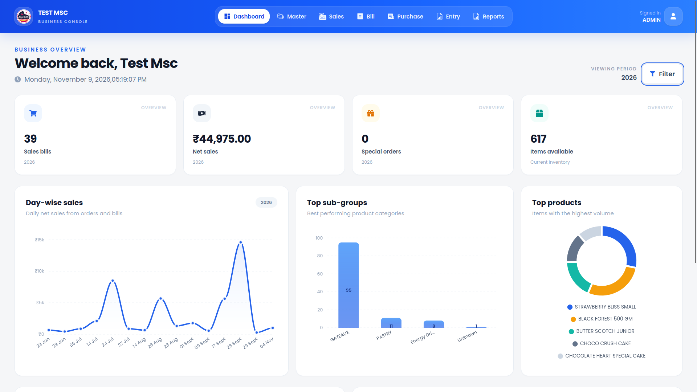

# Nirupam Pal — developer portfolio

A portfolio of production web and mobile work, independent BuildNerd products, and public websites. Built with Next.js, React and TypeScript, deployed as a standalone Node.js application behind Nginx on an Ubuntu VPS.

**[Live portfolio](https://www.inirupampal.in)** · **[Projects](https://www.inirupampal.in/projects)** · **[About](https://www.inirupampal.in/about)** · **[Contact](https://www.inirupampal.in/contact)**



## What the portfolio demonstrates

- A focused homepage, project index and 12 individual case studies.
- Route-based About, Experience, Skills and Contact pages.
- Production POS, franchise ordering, restaurant and staff applications.
- Five independently built BuildNerd products, plus Rupvia and public websites.
- Responsive project cards and an accessible native-dialog screenshot gallery.
- Static project generation, individual metadata, canonical URLs and a sitemap.
- Email contact, GitHub and LinkedIn links, and a downloadable PDF CV.

The TNB case studies explain the move from WhatsApp ordering to software, daily order monitoring, scheduled ERP imports, concurrent-order testing, report indexing, real-time acceptance and WhatsApp message templates. The confirmed usage figure is **200+ franchises using the ordering app daily**; no invented performance percentages are used.

## Routes

| Route | Purpose |
| --- | --- |
| `/` | Introduction and six selected projects |
| `/projects` | All projects, with BuildNerd and mobile filters |
| `/projects/[slug]` | Individual case studies and screenshots |
| `/about` | Background, education and public code links |
| `/experience` | Microace Software and independent product experience |
| `/skills` | Web, mobile, data, cloud and integrations |
| `/contact` | Email and professional profiles |
| `/works` | Permanent redirect to `/projects` |

Examples: [`/projects/tnb-pos`](https://www.inirupampal.in/projects/tnb-pos), [`/projects/tnb-ordering`](https://www.inirupampal.in/projects/tnb-ordering), [`/projects/buildnerd-quotes`](https://www.inirupampal.in/projects/buildnerd-quotes).

## Run locally

Use Node.js 20.9 or newer; production uses Node.js 24.

```bash
npm ci
npm run dev
```

Open `http://localhost:3000`.

```bash
npm run build
npm start
```

The build performs the Next.js production compilation and TypeScript checks. For an HTTP smoke check against a running server:

```bash
node scripts/verify-portfolio.mjs http://localhost:3000
```

## Source map

- `lib/portfolio-content.ts`: profile, skills, project records and screenshot captions.
- `lib/project-case-studies.ts`: project slugs, case-study narratives and related work.
- `app/projects/[slug]/page.tsx`: static project pages and per-project metadata.
- `components/ProjectCards.tsx`: reusable project cards and filters.
- `components/ProjectGallery.tsx`: keyboard-accessible screenshot dialog.
- `components/portfolio.module.css`: shared responsive design.
- `public/projects/`: real product captures and application screenshots.

The existing admin integration supports Supabase content editing; the checked-in project records and case-study data define the generated project routes. Screenshots of demos and sample documents are labelled in their captions.

## Standalone deployment

`next.config.ts` enables `output: "standalone"`. After building, copy `public/` and `.next/static/` into the standalone release before starting it:

```bash
cp -r public .next/standalone/
cp -r .next/static .next/standalone/.next/
PORT=3000 HOSTNAME=127.0.0.1 node .next/standalone/server.js
```

Production uses a separate release directory, health checks before activation, and PM2 to manage the application. Keep runtime credentials outside the repository.

## About the work

Commercial project screenshots demonstrate the interface and described contribution. Employer and client source code is not published in this repository. This repository contains the portfolio itself.
